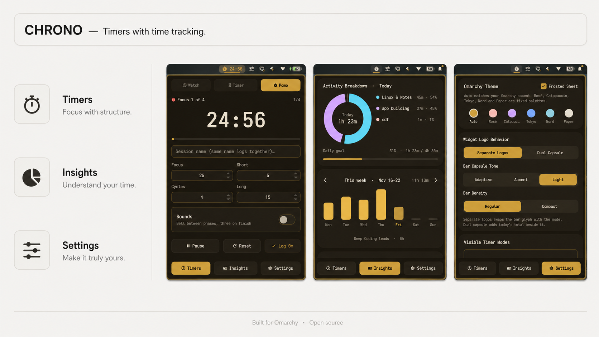
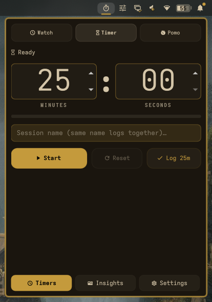
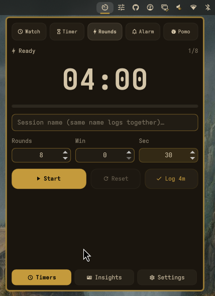
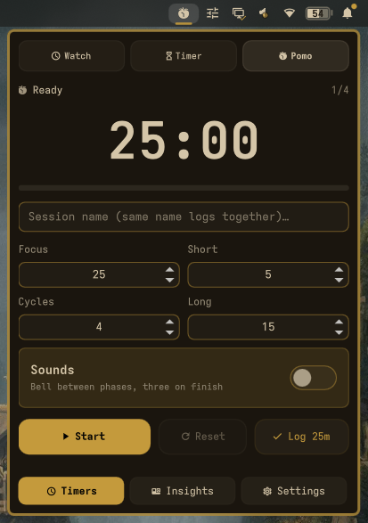
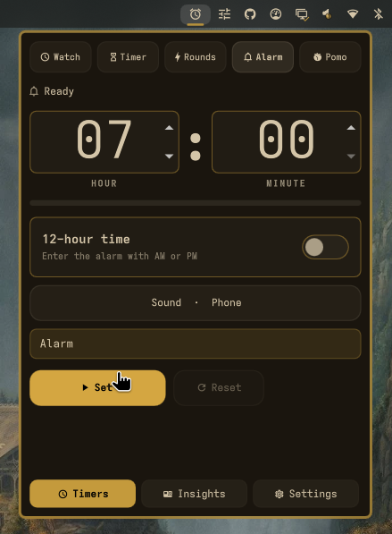
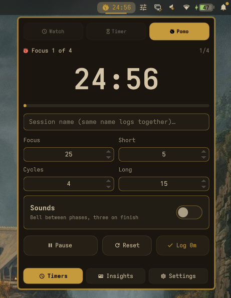
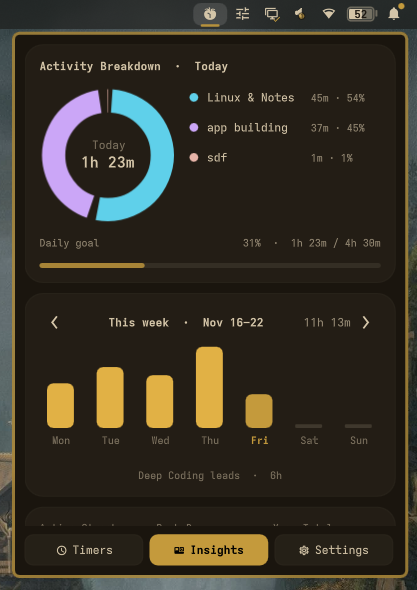
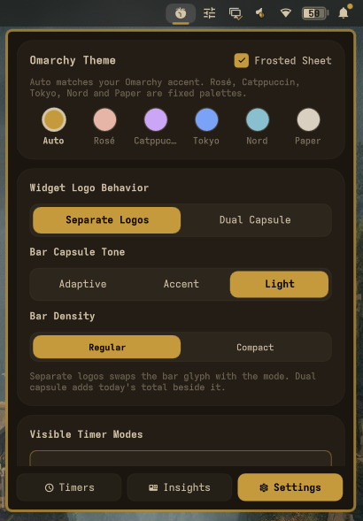
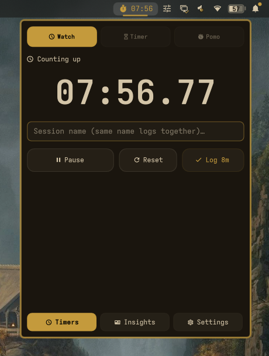

<p align="center">
  
</p>

# Chrono

Bar timers & tracker: Pomodoros, intervals, alarm, insights.

## Install

```bash
omarchy plugin add https://github.com/paudelsamir/chrono.git --enable
```

## Remove

`omarchy plugin remove paudelsamir.chrono`, or delete the folder from `~/.config/omarchy/plugins/`.

## Pages (grid)

| Timers | Rounds |
|:------:|:------:|
|  |  |
| Pomodoro | Alarm |
|  |  |
| Pomodoro running | Insights |
|  |  |
| Settings | Watch |
|  |  |
